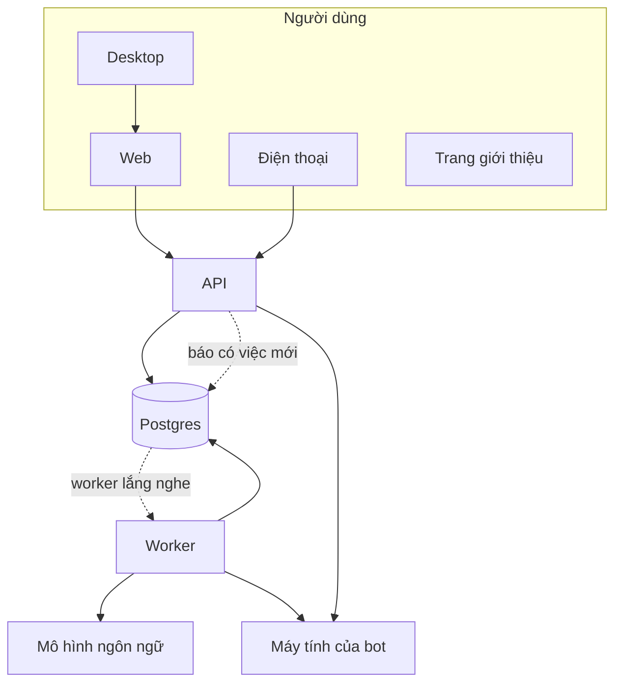
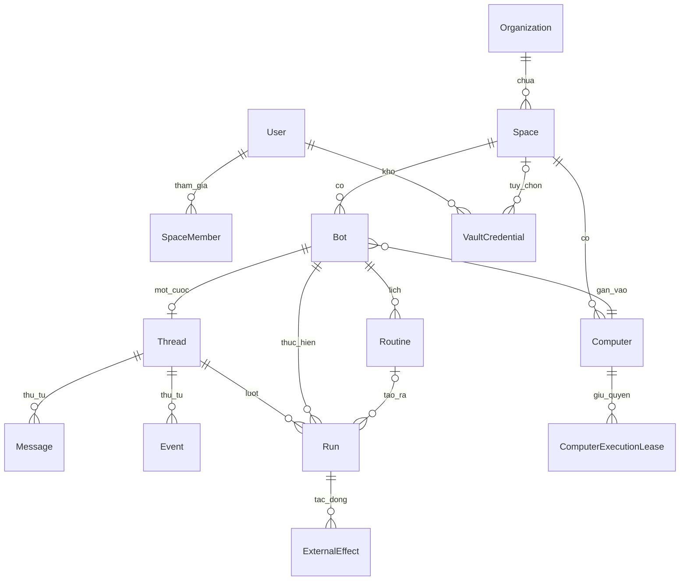
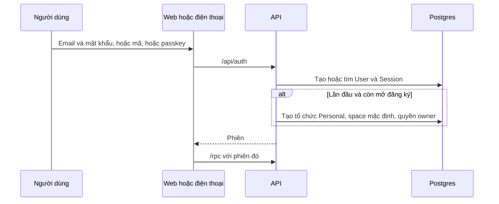
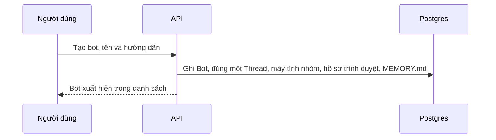
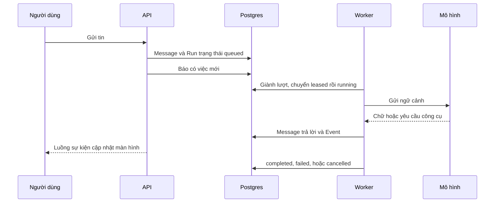
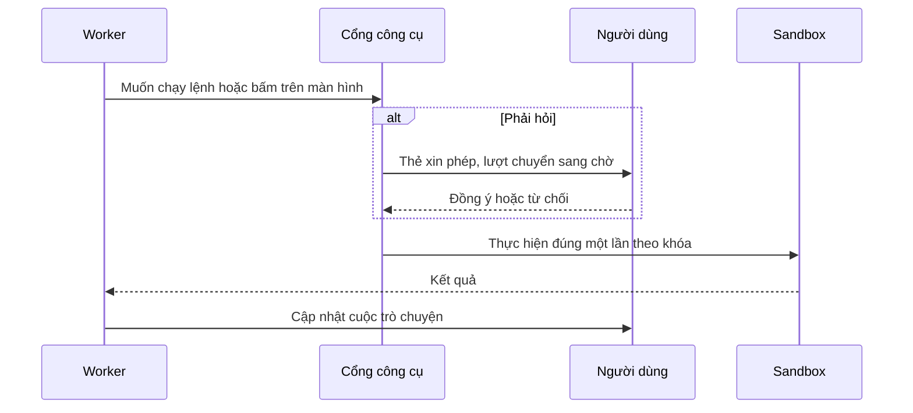
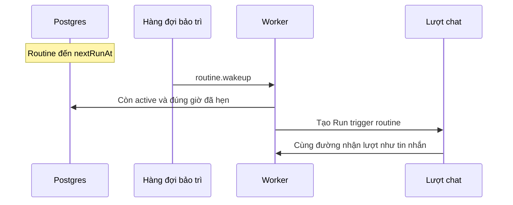
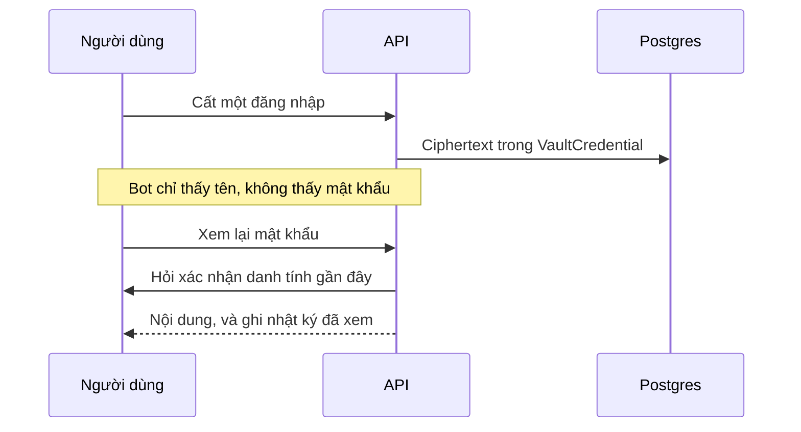
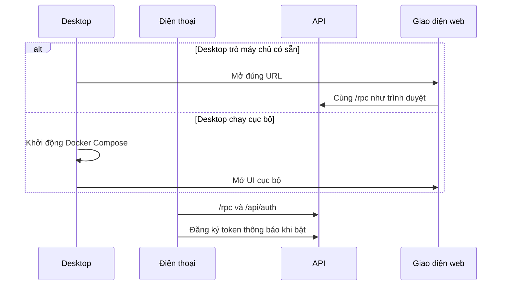

# Bản đồ Rakazo gốc

Đóng băng tại commit `c4b24547`. Đây là Rakazo lúc nhập vào. Không sửa file này, trừ lỗi chính tả. Phần VNBot thêm sau nằm ở `docs/architecture/vnbot/ban-do-vnbot.md`.

Trong mã, tên gói, tên ứng dụng máy tính, vai trò cơ sở dữ liệu, và kênh thông báo ghi Rakazo. Tài liệu này mô tả các khối đó. Nó không đổi tên trong mã và không sửa `LICENSE`.

Bản đồ cho người viết mã (tiếng Anh, có đường dẫn file) nằm ở `docs/architecture/rakazo-baseline/SYSTEM_MAP.md`.

## 1. Nhìn một trang

Rakazo là một sản phẩm trên ba bề mặt dùng hàng ngày: trình duyệt, ứng dụng máy tính (Electron), và điện thoại (Expo). Cả ba nói với cùng một máy chủ API. API ghi việc vào Postgres. Một tiến trình worker đọc việc đó và chạy lượt của bot. Khi bot cần tệp, terminal, hoặc màn hình, worker mở một máy tính tách biệt (sandbox). Mô hình ngôn ngữ, nhà cung cấp máy tính, email, thanh toán, và kênh chat bên ngoài đều gắn thêm được. Tắt chúng thì đăng nhập, chat, và lịch vẫn còn.

Trang giới thiệu (`www`) là site tĩnh, không phải chỗ người dùng chat với bot.

Các gói dùng chung nằm giữa ba bề mặt và máy chủ: hợp đồng API, quy tắc nghiệp vụ, cơ sở dữ liệu, đăng nhập, giao diện, và các nhà cung cấp gắn ngoài.

## 2. Từng khối làm gì

### Web

Ứng dụng React trong trình duyệt. Người dùng đăng nhập, tạo bot, nhắn tin, xem màn hình máy tính của bot, và chỉnh cài đặt tại đây. Web không tự chạy mô hình. Nó gửi ý định lên API và vẽ trạng thái API trả về. Ở máy phát triển, Vite chuyển tiếp các đường `/rpc` và `/api` sang API.

### Desktop

Vỏ Electron bọc đúng giao diện web. Có hai cách mở: trỏ tới một máy chủ có sẵn, hoặc tự chạy cả chồng dịch vụ trên máy người dùng bằng Docker. Khi đã đăng nhập, desktop có thể cho bot chạy lệnh trên chính máy đó, sau khi người dùng đồng ý. Đây là đường nhạy cảm: lệnh chạy trên máy thật, không nằm trong hộp tách biệt.

### Điện thoại

Ứng dụng Expo, giao diện viết riêng cho iOS và Android, nhưng gọi cùng API với web. Đăng nhập dùng cùng hệ phiên. Thông báo đẩy đi qua Expo khi được bật. Một số thao tác dùng control gốc của hệ điều hành (menu, cảnh báo, nút), nên màn hình không sao chép từng pixel của web.

### API

Cửa HTTP duy nhất của sản phẩm. Nhận đăng nhập, nhận mọi thao tác (tạo bot, gửi tin, duyệt máy tính, lịch, kho mật khẩu), kiểm tra quyền theo không gian làm việc, rồi ghi Postgres. API không giữ luồng mô hình lâu. Nó tạo một lượt chạy và báo cho worker.

### Worker

Tiến trình chạy nền. Nó nhận lượt chat, gọi mô hình, gọi công cụ, và nói chuyện với máy tính của bot. Nó cũng đốt lịch, dọn máy tính nhàn rỗi, và gửi tin ra kênh bên ngoài sau khi lượt đã ghi xong. Worker và API phải dùng chung cơ sở dữ liệu và khóa mã hóa. Lệch khóa thì không đọc được mật khẩu đã lưu.

### Trang giới thiệu

Site Astro: trang chủ, blog, trang pháp lý, bản địa hóa marketing. Không nằm trong luồng chat. Đổi câu chữ marketing không đụng dữ liệu bot.

### Hợp đồng và quy tắc

Hợp đồng là danh sách thao tác web và điện thoại được phép gọi, kèm dạng dữ liệu. Quy tắc nghiệp vụ (trạng thái lượt chạy, lúc nào phải hỏi người dùng, cách hiểu lịch cron) nằm một chỗ, không viết lại trong từng ứng dụng.

### Cơ sở dữ liệu

Postgres qua Prisma. Mọi thứ bền nằm ở đây: người dùng, bot, tin nhắn, lượt chạy, lịch, máy tính, mật khẩu. Phân quyền dòng (RLS) giới hạn mỗi kết nối vào một không gian làm việc. Tài khoản ứng dụng không phải tài khoản chủ schema. Nếu hai việc đó dùng chung một tài khoản, hàng rào này không có tác dụng.

### Đăng nhập

Better Auth: mật khẩu, mã email, passkey, và đăng nhập doanh nghiệp khi bật. Sau lần vào đầu tiên, hệ thống tạo một tổ chức cá nhân và một không gian làm việc mặc định tên Personal.

### Bộ gắn ngoài

Mọi thứ có thể thay nhà cung cấp nằm ở đây: mô hình (mặc định là Pi), máy tính (Docker, E2B, Novita, Daytona, CreateOS, Boat, Railway, Kubernetes, hoặc máy người dùng), bộ nhớ, email, thanh toán, Slack, Telegram, WhatsApp, và các kho công cụ MCP. Tắt nhà cung cấp thì API vẫn khởi động, máy tính của bot chuyển sang trạng thái không có.

### Giao diện dùng chung

Màu và chữ nghĩa (nền, thẻ, viền, màu nguy hiểm) nằm một nguồn. Web và desktop dùng bộ component. Điện thoại đọc cùng bảng màu nhưng vẽ bằng style riêng. Khung chat (markdown) dùng chung cho web và điện thoại.

### Máy tính của bot và supervisor

Với Docker, một tiến trình supervisor nhận lệnh từ API và worker, rồi điều khiển container. Ảnh bên trong container là máy tính của bot: trình duyệt, terminal, tệp. Nhà cung cấp từ xa không dùng supervisor local. Họ nhận cùng một giao diện, khác chỗ máy thật chạy.

### Cập nhật bản cài

Có sidecar tùy chọn để kéo bản Compose mới. Không bắt buộc để chat chạy. Railway có bộ file triển khai riêng.

## 3. Dữ liệu chính

Một người có một tổ chức và một hoặc nhiều không gian làm việc. Bot, tin nhắn, lượt chạy, và máy tính đều thuộc một không gian. Mỗi bot có đúng một cuộc trò chuyện riêng. Nhóm chat và cuộc hội thoại từ Slack hoặc kênh tương tự cũng mỗi cái một cuộc trò chuyện, không dùng chung hàng của bot.

Mỗi dòng dưới là một ý nghĩa, không phải mô tả cột.

| Tên trong cơ sở dữ liệu | Ý nghĩa |
| --- | --- |
| User | Tài khoản đăng nhập. |
| Organization | Vỏ hội viên và thanh toán phía trên không gian. |
| Space | Không gian làm việc. Hầu hết dữ liệu thuộc về một space. |
| SpaceMember | Người này được vào space nào, vai trò gì. |
| Bot | Một đồng đội: tên, hướng dẫn, màu, máy tính đang gắn. |
| Thread | Một cuộc trò chuyện. Thuộc đúng một bot, hoặc một nhóm, hoặc một kênh ngoài. |
| Message | Một tin trong cuộc trò chuyện, có số thứ tự. |
| Event | Một sự kiện giao diện áp dụng (hỏi, xong, lỗi, máy tính). Cũng có số thứ tự, không phải là tin nhắn. |
| Run | Một lượt bot làm việc: xếp hàng, đang chạy, đang chờ người, xong, lỗi, hoặc hủy. |
| SteeringMessage | Tin người dùng gửi thêm khi lượt trước chưa xong. |
| Routine | Lịch, webhook, hoặc theo dõi thay đổi. Đến giờ thì tạo một Run. |
| Computer | Máy tính của bot, dùng chung theo nhóm hoặc riêng một bot. |
| ComputerExecutionLease | Quyền đang giữ máy đó để một lượt chạy lệnh. |
| ComputerRun | Khoảng thời gian máy bật, dùng để tính giờ với nhà cung cấp. |
| ExternalEffect | Một việc đã đụng ra ngoài (gửi, ghi, mua). Ghi một lần theo khóa, không làm đôi. |
| VaultCredential | Mật khẩu và đăng nhập người dùng cất trong kho. |
| BotSecret | Bảng mật khẩu cũ theo từng bot, còn giữ để bản trước vẫn chạy. |
| Secret và AgentSecret | Bí mật đặt tên cho công cụ trong space, khác kho đăng nhập. |
| MemoryDocument | Tệp nhớ dạng markdown, trong đó có MEMORY.md của bot. |
| Artifact | Tệp đính kèm hoặc file bot tạo. |
| Session, Account, Passkey | Phiên và cách đăng nhập. |

## 4. Hành trình người dùng

### Đăng ký và đăng nhập

Đăng ký có thể tắt, hoặc chỉ nhận một danh sách email. Mật khẩu lộ trong kho rò rỉ có thể bị chặn khi bật kiểm tra đó. Passkey và đăng nhập doanh nghiệp là tùy chọn.

### Tạo bot

Tạo bot không mở container ngay. Máy tính được cấp khi một lượt thực sự cần nó. Bot có thể chuyển sang máy riêng sau.

### Một lượt chat

Trạng thái đi một chiều đã chốt: xếp hàng, được nhận, đang chạy, có thể chờ người trả lời hoặc chờ người cầm màn hình, rồi xong, lỗi, hoặc hủy. Lượt lỗi có thể được xếp lại một lần. Lượt đã xong hoặc đã hủy không chạy lại.

Nếu thông báo bị mất, worker vẫn quét vài giây một lần và nhận các lượt đến hạn. Nhiều worker có thể cùng nhìn một hàng. Chỉ worker ghi được số phiên bản mới được tiếp tục. Worker cũ bị từ chối.

Lượt do lịch, webhook, hoặc bot khác tạo không nuốt tin người dùng đang gõ dở. Tin đó chờ, rồi được trả lời sau.

### Bot dùng máy tính, và cổng xin phép

Ba mức hỏi: luôn hỏi trước việc có tác động, để mô hình duyệt rồi mới hỏi chỗ chưa chắc, hoặc không chờ. Mức không chờ vẫn từ chối việc do người ngoài xúi, hoặc việc người dùng không phải người mở lượt. Lệnh trên chính máy của người dùng luôn hỏi, kể cả khi mức là không chờ.

Máy tính có hai kiểu giữ quyền: quyền chạy lệnh, và quyền cầm màn hình. Người dùng có thể lấy màn hình (takeover). Khi đó lượt chờ, không vừa chạy vừa tranh chuột.

### Lịch chạy

Sửa lịch hoặc tắt lịch trước giờ hẹn thì lần đánh thức cũ không tạo thêm lượt. Một routine chỉ có một lần đánh thức đang chờ. Lịch bị trễ vẫn chạy, không bị bỏ. Nếu máy chủ tắt lâu, bot được biết cả giờ đáng lẽ chạy và giờ thực tế.

### Kho mật khẩu

Kho mặc định là của cả tài khoản, mọi space dùng chung. Một space có thể tách kho riêng. Bảng mật khẩu cũ theo từng bot vẫn còn để bản phần mềm trước không gãy trong lúc nâng cấp. Đừng xóa bảng đó trong cùng một lần triển khai.

### Desktop và điện thoại

Desktop không có API riêng. Điện thoại cũng không. Khác nhau ở vỏ: Electron mở web, Expo vẽ màn hình riêng và gọi cùng hợp đồng.

## 5. Đổi giao diện đụng đâu

Màu sản phẩm nằm một file nguồn. Sinh ra file CSS cho web và desktop. Điện thoại đọc cùng bảng màu trong mã. Các tên màu là vai trò: nền, thẻ, chữ mờ, viền, màu phá hủy, thành công, cảnh báo. Nền chính là mực, không phải một màu thương hiệu riêng. Màu nhận diện của từng bot là ngoại lệ: một danh sách màu cố định lúc tạo bot. Đổi bảng màu giao diện không sơn lại bot đã tạo.

Đổi nhìn và cảm giác trên mọi bề mặt dùng:

- Bảng màu chung, rồi sinh lại CSS.
- Component web, vì desktop nhúng bản build web.
- Lớp màu của điện thoại, nếu token mới cần một chỗ áp dụng.
- Site giới thiệu, vì nó build riêng dù dùng chung thư viện.

Đổi câu chữ thì mỗi bề mặt một chỗ: web có catalog dịch, điện thoại có catalog ngắn hơn, site giới thiệu có trang riêng. Thêm ngôn ngữ không đụng dữ liệu bot. Web đang có nhiều ngôn ngữ hơn điện thoại. Thêm ở một nơi không tự xuất hiện ở nơi kia.

Icon và tên hiện trên desktop nằm ở cấu hình đóng gói Electron và thư mục tài sản thương hiệu. Tên gói trong mã vẫn là Rakazo.

## 6. Chỗ cắm thêm, và phần lõi

Cắm thêm mà không viết lại lõi:

- Nhà cung cấp máy tính mới, miễn là nói cùng giao diện provision, chạy lệnh, màn hình, tệp, dừng, xóa.
- Nguồn công cụ: MCP, Composio, Pipedream, hoặc connector tự cài.
- Kênh chat: Slack, Telegram, WhatsApp, và các kênh đã có chỗ nhận webhook trên API. Tin đến phải vào API, không để worker vừa nghe vừa poll.
- Ngôn ngữ giao diện, theo catalog của từng bề mặt.
- Thanh toán và ví, email giao dịch, giọng nói, bộ nhớ ngoài. Tắt thì sản phẩm vẫn đăng nhập và chat được nếu đã có mô hình.
- Một việc nền không phải lượt chat, bằng một loại job mới trên hàng bảo trì.

Phần lõi, đừng nới để “tiện một tính năng”:

- Mỗi bot một cuộc trò chuyện. Mỗi thread thuộc đúng một chủ: bot, nhóm, hoặc hội thoại ngoài.
- Lượt chạy và sự kiện có số thứ tự riêng, trạng thái chỉ đi theo bảng đã chốt, và chỉ một worker giữ được số phiên bản.
- Đăng nhập ra một người trong một space. Truy vấn thường chỉ thấy dòng của space đó. Việc đi xuyên space phải ghi rõ lý do.
- Hiệu ứng ra ngoài ghi một lần theo khóa, để nút đồng ý không gửi đôi.
- API và worker dùng chung khóa mã hóa và cùng mắt nhìn về máy tính của bot.
- Tên kỹ thuật Rakazo trong mã, vai trò cơ sở dữ liệu, và scheme ứng dụng. Đổi nhãn hiển thị là việc giao diện. Đổi các tên này là việc di cư.

Nâng cấp production chạy API cũ và API mới cạnh nhau vài giây sau khi migration áp dụng. Migration chỉ được thêm bảng và cột trước. Xóa hoặc đổi tên để lần triển khai sau, khi không còn tiến trình nào đọc tên cũ.
