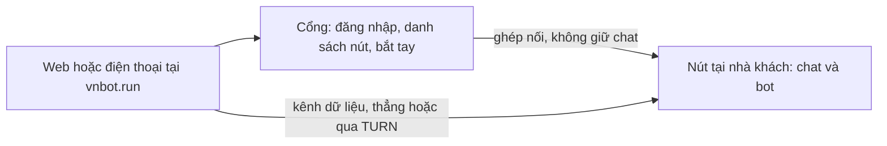

# Bản đồ VNBot

VNBot hôm nay vẫn là Rakazo gốc, cộng hai thay đổi đã vào mã. Bản đóng băng tại commit `c4b24547` nằm ở `docs/architecture/rakazo-baseline/ban-do-rakazo-goc.md`. Nhật ký nằm ở `docs/architecture/vnbot/CHANGELOG-ARCHITECTURE.md`.

Đăng nhập có thể chỉ còn mã email: `AUTH_EMAIL_CODE_ONLY` đóng đường mật khẩu, passkey vẫn dùng được. `AUTH_EMAIL_ALLOWLIST=on` thì chỉ email trong bảng `auth_email_allowlist` nhận được mã, tạo được tài khoản, hoặc mở được phiên. Địa chỉ không có trong danh sách nhận HTTP 403 `EMAIL_NOT_INVITED` và không có email. Bot mới mặc định bộ avatar `vnbot`; bot cũ giữ bộ đã lưu.

## Đề xuất: cổng vnbot.run và máy của khách

Khách chạy cả hệ thống trên máy của họ (Mac mini ở nhà, máy văn phòng, hoặc VPS của họ). Máy đó là một nút: API, worker, cơ sở dữ liệu, và máy tính của bot. Dữ liệu chat ở lại đó.

vnbot.run là cổng chúng ta giữ. Người dùng đăng nhập bằng email trên web hoặc điện thoại, thấy các nút đã ghép, và điều khiển nút từ xa. Cổng không lưu cuộc trò chuyện. Nó chỉ biết ai được vào nút nào, giúp hai bên tìm nhau, và chuyển tiếp khi mạng nhà không mở đường thẳng.

Điện thoại hoặc trình duyệt nói với nút bằng WebRTC. Phần chat đi trên kênh dữ liệu. Hình và tiếng, nếu có, là bước sau. Khi hai bên không nối thẳng được, máy TURN của cổng chỉ chuyển gói đã mã hóa.

Nút không cần mở cổng vào. Một chương trình nhỏ trên nút tự gọi ra cổng để giữ đường bắt tay.

Quyền: đăng nhập ở vnbot.run chỉ đủ để xin nối vào nút của mình. Nút tự kiểm tra chữ ký và người đó đã được ghép chưa, rồi mới cho gọi API. Mật khẩu và phiên của nút không gửi lên cổng.

Hôm nay web gọi `/rpc` và `/api/auth` ngay trên trang đang mở. Điện thoại gọi một địa chỉ https. Cả hai đều là HTTP tới một máy. Đề xuất thêm một lớp vận chuyển để cùng những lời gọi đó chạy trên kênh WebRTC khi người dùng đang ở vnbot.run. Máy ở nhà vẫn dùng https trực tiếp.

Ba bước: trước hết https tới nút qua đường hầm; rồi kênh dữ liệu WebRTC; sau cùng mới tới hình và tiếng trên cùng kết nối đó. Ảnh màn hình bot bên trong nút không phải việc của đề xuất này.

Quyết định đang ở trạng thái đề xuất: `docs/architecture/vnbot/adr/0001-hosted-gateway-and-self-hosted-node-over-webrtc.md`.
